# LevelDB 初步设计方案

这是我们小组 LevelDB 的 TTL 与元数据统计两部分的技术设计方案文档。

## LevelDB TTL 技术设计方案

文档先说明 LevelDB 现有的日志、版本和 Compaction 机制，再给出记录级 TTL 的初步设计、数据流、读取语义、快照约束、Compaction 安全回收路径。

文档中的 TTL 设计属于本项目拟采用的扩展方案。

### 一、现有机制与扩展定位

LevelDB 是一个基于日志和 LSM 文件组织的键值存储系统。用户写入 `key=value`，系统不会只保留一个最终值，而是给每次写入分配一个递增的 `sequence`，并把记录逐步放进日志、内存表和磁盘文件。

例如，用户连续写入：

```text
put(k, v1)  -> sequence 10
put(k, v2)  -> sequence 11
delete(k)   -> sequence 12
```

磁盘上可能暂时同时存在这三条内部记录。读取时，LevelDB 根据一个版本边界找到当前视图能看到的最新记录。如果最新记录是删除标记，读取结果就是不存在；旧的 `v1` 和 `v2` 不会重新出现。

#### 1.1 LevelDB 原有的写入链路


| 环节         | 通俗解释                       | 与 TTL 的关系                                                   |
| ------------ | ------------------------------ | --------------------------------------------------------------- |
| `WriteBatch` | 把一批写入作为一个整体提交     | 新增 `kTypeValueWithTTL` 记录类型，携带 key、`expire_at`、value |
| `sequence`   | 每条写入的版本编号             | TTL 读取仍然要先按 sequence 找最新版本                          |
| `WAL`        | 机器崩溃后用来恢复写入的日志   | `expire_at` 必须随记录进入日志                                  |
| `MemTable`   | 内存中的暂存区域               | 记录在这里已经携带 TTL 信息                                     |
| `SST`        | 不可变的磁盘文件               | 需要保存过期字段和文件级过期摘要                                |
| `Compaction` | 合并文件并清理确定无用的旧记录 | TTL 的物理回收在这里完成                                        |
| `Version`    | 当前数据库由哪些文件组成的视图 | 统计和回收都要跟随 Version 的切换                               |

#### 1.2 原生 LevelDB 与本方案的差别

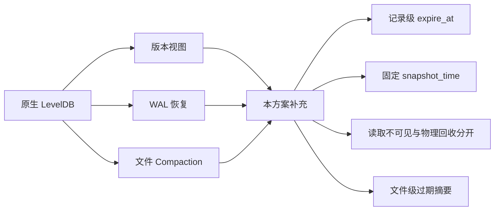

原生 LevelDB 的主干机制已经能够回答“某个版本下应该返回哪个值”，但它没有回答下面四个问题：

1. 一条记录什么时候自动失效？
2. 同一个快照在时间推进后，读取结果是否还保持稳定？
3. 记录已经逻辑过期但尚未物理删除时，应该怎样处理？
4. 后台如何知道哪个文件值得优先检查过期记录？

所以本方案不重做 LevelDB，而是沿着原来的数据链路补四个边界：

- **写入边界**：保存绝对截止时间 `expire_at`。
- **读取边界**：用固定的序列号和固定的读取时间判断可见性。
- **回收边界**：只有不再破坏旧视图时，Compaction 才能删除记录。
- **调度边界**：文件级过期摘要只用于选择候选，不作为删除的安全证明。

#### 1.3 整体生命周期

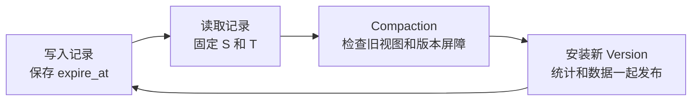

数据库长期运行会反复经过写入、读取、回收和发布四个阶段：新记录不断写入，读取使用当前视图，后台合并回收旧记录，最后发布新的文件视图。

#### 1.4 三个设计原则

##### 原则一：可见性和回收分开

记录到期后读取立即返回 `NotFound`，不需要等待后台 Compaction。磁盘回收是另一个问题：即使当前读不到，旧快照仍可能需要这条记录，所以不能马上删除。

##### 原则二：读取视图必须固定

一个快照至少需要两个参数：

```ini
snapshot_seq  = S
snapshot_time = T
```

`S` 决定最多看到哪个版本，`T` 决定 TTL 判断使用哪个时间。只固定 `S` 而每次读取都重新取系统时间，会导致同一个快照前后返回不同结果。

##### 原则三：回收必须服从版本保护

Compaction 不能只看 `expire_at < now`。它还要判断：

- 某个旧快照是否仍可能读取这条记录。
- 删除当前记录后，旧值是否会重新露出来。
- 当前输入文件是否已经具备安全的版本屏障。

#### 1.5 代码落点总览

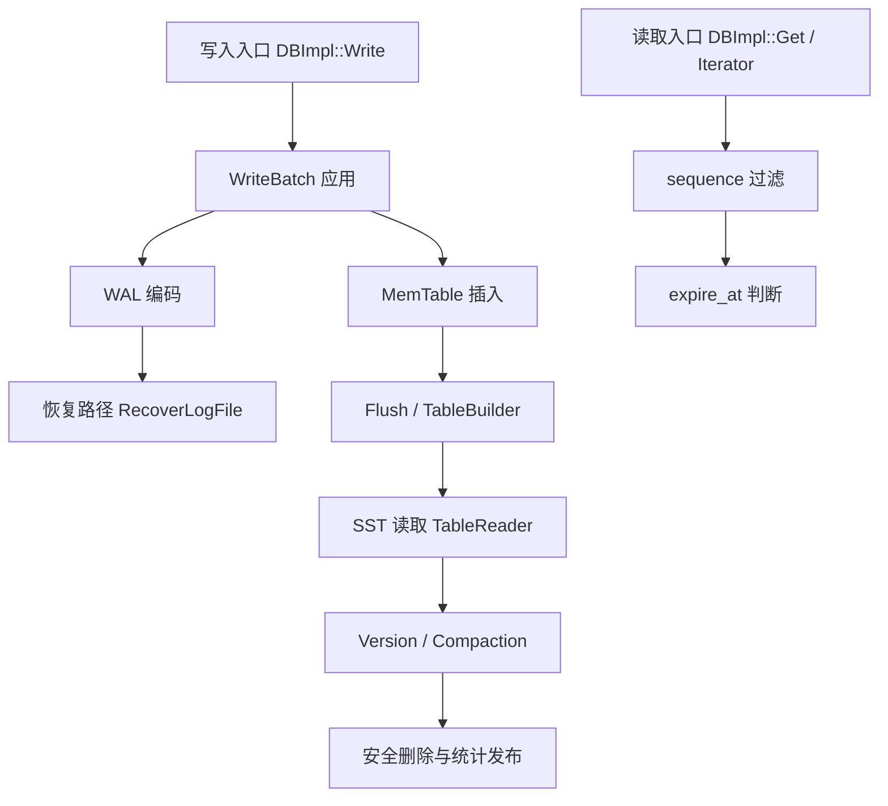

`expire_at` 必须进入 WAL 和 SST，否则重启后可能丢失截止时间，或者因重新计算相对 TTL 造成意外续期。

### 二、TTL：让记录按时间失效

#### 2.1 TTL 到底是什么

TTL 表示“这条记录最多有效多久”。例如：

```text
现在时间 now = 100
TTL = 10 秒
保存 expire_at = 110
```

读取时间小于 `110` 时记录可见；大于等于 `110` 时不可见。

本方案保存**绝对截止时间**，不是只保存相对时长。绝对时间可以直接写入日志和 SST，重启后仍然知道原来的截止点。

#### 2.2 TTL 写入流程


写入 ttl=0 时约定 expire_at=0，表示永久有效。普通 Put 在存储中不携带 expire_at 字段，读取时逻辑上视为 0，与 TTL 记录的永久语义一致。

系统不能在每次打开数据库时重新计算 `expire_at = 当前时间 + ttl`，否则相当于给记录续期。

#### 2.3 记录格式与存储位置

本方案**不修改 internal key 的排序结构**，TTL 元数据通过两层编码承载：

- **WriteBatch 层**：新增 `kTypeValueWithTTL` 记录类型，作为批量路径和 WAL 中的显式类型标记。
- **MemTable / SST 层**：TTL 记录的 value 以 8 字节前缀保存 `expire_at`，供读取路径和 Compaction 直接解析。

选择这个方案的理由：

- internal key 的排序和比较逻辑是 LevelDB 最敏感的部分，改动 `ParsedInternalKey` / `InternalKeyComparator` 影响面大且容易引入排序错误。
- WriteBatch 层的类型标记让 TTL 记录在批量路径、WAL 和恢复路径中有明确身份，`Iterate` 可以按 tag 分发，不需要靠 value 内容猜测。
- MemTable / SST 层的值前缀让记录值本身携带绝对截止时间，读取和 Compaction 不需要回查外部元数据。
- 保留原有 key 排序和 sequence 规则，旧 SST 与新 SST 的 key 布局兼容。

##### 第一层：WriteBatch 记录编码

普通 Put 的原生编码是：

```text
kTypeValue | varstring(key) | varstring(value)
```

TTL Put 新增 `kTypeValueWithTTL` 类型，编码为：

```text
kTypeValueWithTTL | varstring(key) | fixed64(expire_at) | varstring(value)
```

| 字段                | 含义                                                                   | 示例     |
| ------------------- | ---------------------------------------------------------------------- | -------- |
| `kTypeValueWithTTL` | 新增的 `ValueType`，同时用作 WriteBatch 的 tag 和 internal key 的 type | 新增类型 |
| `key`               | 用户 key，与普通 Put 相同                                              | `k`      |
| `expire_at`         | 绝对截止时间，fixed64，独立字段                                        | `110000` |
| `value`             | 用户 value                                                             | `v_new`  |

`kTypeValueWithTTL` 定义在 `db/dbformat.h` 的 `ValueType` 枚举中，因为 WriteBatch 和 internal key 共享 tag 空间，它同时承担两个角色：在 WriteBatch 中标识“这是一条 TTL 记录”，进入 MemTable 和 SST 后作为 internal key 的 type 保留，读取端靠它区分 TTL 记录和普通记录。

`expire_at` 在 WriteBatch 中是**独立字段**，与 key、value 并列，不嵌入 value。`WriteBatch::Iterate` 遇到 `kTypeValueWithTTL` 时，解析出三个参数并调用 `handler->PutWithTTL(key, expire_at, value)`；遇到 `kTypeValue` 时仍调用 `handler->Put(key, value)`。

##### 第二层：MemTable / SST 的 value 编码

`MemTableInserter::PutWithTTL` 把 `expire_at` 写入 value 的前 8 字节，后面紧跟用户 value：

```text
fixed64(expire_at) | user_value
```

| 字段         | 含义                               | 示例     |
| ------------ | ---------------------------------- | -------- |
| `expire_at`  | 绝对截止时间，fixed64，固定 8 字节 | `110000` |
| `user_value` | 用户真正写入的值                   | `v_new`  |

这一层没有额外的 `format_version` 或 `flags` 字段。`expire_at=0` 表示永久有效，仍然占用 8 字节，避免变长解析。

##### 两种 value 布局共存

进入 MemTable 和 SST 后，**TTL 记录和普通记录的 value 布局不同**：

| internal key type   | value 布局                           |
| ------------------- | ------------------------------------ |
| `kTypeValue`        | `user_value`（无前缀，保持原生格式） |
| `kTypeValueWithTTL` | `expire_at(8B) \| user_value`        |

普通 Put 走 `MemTableInserter::Put`，value 就是用户原始值；TTL Put 走 `MemTableInserter::PutWithTTL`，value 前 8 字节是 `expire_at`。读取端**先看 internal key 的 type**：`kTypeValueWithTTL` 才解析前 8 字节，`kTypeValue` 直接返回用户值。两种布局共存，不需要统一，也不需要额外的版本字节。

##### 两层编码的职责分工

两层编码不是二选一，而是同时存在、职责不同：

| 层次           | 编码                                         | 职责                                                                      |
| -------------- | -------------------------------------------- | ------------------------------------------------------------------------- |
| WriteBatch     | `tag \| key \| expire_at \| value`           | 在批量路径、WAL 和恢复路径中显式标记 TTL 类型，支持 `Iterate` 按 tag 分发 |
| MemTable / SST | `expire_at(8B) \| user_value`（仅 TTL 记录） | 在记录值中持久化绝对截止时间，供读取判断和 Compaction 解析                |

前者是“类型标记”，后者是“数据存储”。`WriteBatch::Iterate` 负责把第一层的 `expire_at` 解出来，`MemTableInserter::PutWithTTL` 负责把它编码成第二层的前缀。恢复路径 `RecoverLogFile` 重放 WAL 时走同一个 `Iterate` 和 `PutWithTTL` 路径，因此两层编码在正常写入和崩溃恢复中保持一致。

工程参考是 SlateDB RFC《Timestamps and TTL》，其中讨论了显式时间字段以及读取和 Compaction 的处理方式：

- [SlateDB RFC 0003: Timestamps and TTL](https://slatedb.io/rfcs/0003-timestamps-and-ttl/)

#### 2.4 TTL 读取流程

读取不能先扫描到一条“没有过期的旧值”就返回，而应该先找到当前视图中的**最新版本**，再判断它是否到期。

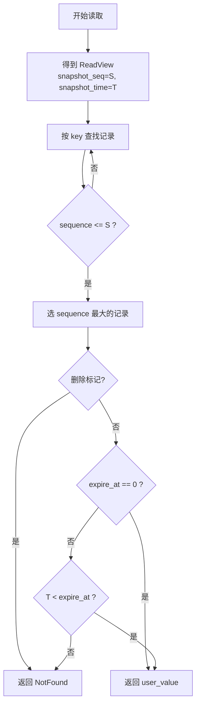

两个不可交换的顺序约束：

1. **先按 `sequence` 定位最新记录，再判断 TTL。**
2. **最新记录过期后直接返回不存在，不回退旧版本。**

不能回退旧版本的原因：

```text
t=100: put(k, v_old)，永久有效，sequence=10
t=105: put(k, v_new)，TTL=5，expire_at=110，sequence=11
t=110: 读取 k
```

在 `t=110`，系统先找到 sequence=11 的 `v_new`，它已到期，结果是 `NotFound`。如果跳过过期的 `v_new` 返回 `v_old`，就会让已被覆盖的数据重新出现。

##### `Version::Get` 的状态机改动

原生 `Version::Get` 在某一层找到满足 `sequence <= snapshot` 的记录时，通过 `SaveValue` 回调返回并停止继续查找。引入 TTL 后，需要区分四种概念结果：

```text
FOUND_VALUE      -> 返回 user_value
FOUND_EXPIRED    -> 记录已过期，停止继续向更低层查找，最终返回 NotFound
FOUND_DELETION   -> 返回 NotFound
NOT_FOUND        -> 继续向下一层查找
```

以上是概念名。实现时映射到原生 `Saver::State`（`kNotFound` / `kFound` / `kDeleted` / `kCorrupt`），并新增 `kExpired` 作为终止状态。

关键点：一旦在某一层找到“最新版本”（满足 sequence 条件），无论它是否过期，都不再继续向更低层查找。`FOUND_EXPIRED` / `kExpired` 必须作为终止状态，而不是 `kNotFound`。

#### 2.5 普通读取和快照读取的区别

普通 `Get` 使用当前 `LastSequence` 和当前时钟；快照读取在创建时保存两个值：

```text
snapshot_seq  = S
snapshot_time = T
```

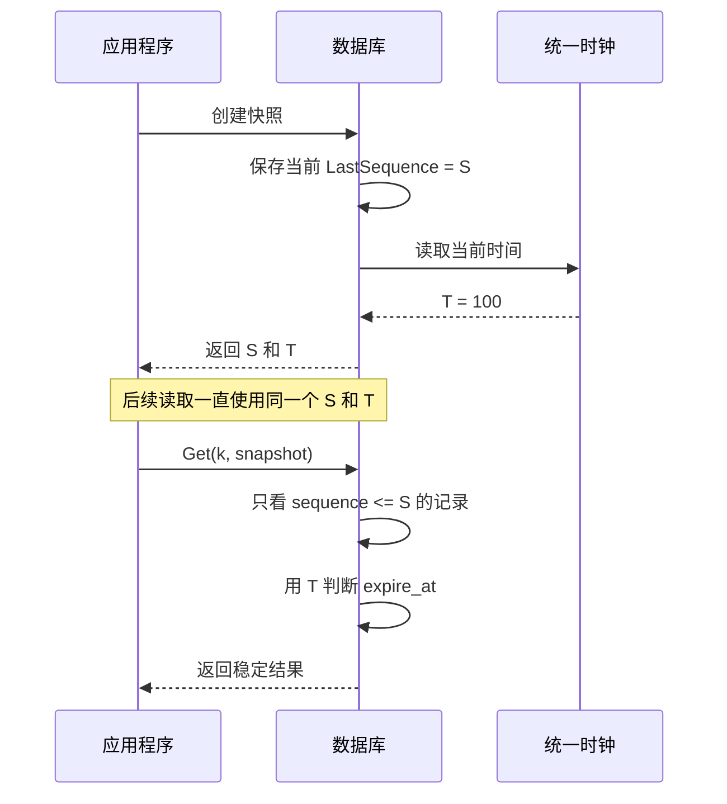

快照在 `T=100` 创建，某条记录 `expire_at=110`。即使真实时间到了 `120`，该快照仍按 `T=100` 判断，结果不变。

##### 快照时间的存放位置

原生 `SnapshotImpl` 只持有一个 `SequenceNumber`。本方案扩展为：

```cpp
class SnapshotImpl : public Snapshot {
  SequenceNumber number_;
  uint64_t snapshot_time_;   // 新增
};
```

`DBImpl::GetSnapshot()` 在分配 sequence 后读取一次 `Clock.Now()` 写入 `snapshot_time_`；`ReleaseSnapshot()` 释放时无需额外清理时间字段。快照句柄本身即承载 `{S, T}`，不需要额外的全局映射表。

测试时注入 `FakeClock`：

```text
FakeClock.Set(100)
snapshot = db.CreateSnapshot()   // snapshot_time = 100

FakeClock.Set(120)
db.Get(key, snapshot)            // 仍然按 100 判断
```

#### 2.6 迭代器为什么也要固定时间

迭代器可能持续扫描一段时间。如果每次 `Next()` 都重新读取系统时间，同一个迭代器前后可能使用不同的时间边界，结果不再稳定。

#### 2.7 到期不可见和物理删除是两个动作

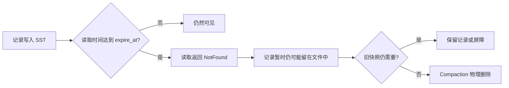

“读取已经不存在”和“磁盘空间已经释放”可能相隔一段时间。读取优先保证用户看到正确结果，回收等待安全条件满足。

#### 2.8 Compaction 安全回收流程

##### 文件级过期摘要

在每个 SST 的 `FileMetaData` 中新增：

```cpp
uint64_t oldest_expire_at;   // 文件中最小非零 expire_at，0 表示全部永久
uint64_t newest_expire_at;   // 文件中最大 expire_at
uint64_t expired_count;      // 构建时统计的已过期记录数（估计值）
```

- 摘要在 `BuildTable` 写入记录时同步累计，随 `VersionEdit` 持久化到 MANIFEST。
- 重启后从 MANIFEST 恢复，不需要重新扫描 SST。
- `expired_count` 只是调度估计值，**不作为删除的安全证明**。
- 摘要统计发生在构建时刻，之后记录陆续过期不会自动更新摘要，因此 `expired_count` 会随时间偏离实际值。这一点不影响安全性，只影响调度精度。

#### 逐条安全判断条件

原生 `DoCompactionWork` 的 drop 规则有两条：

```text
规则 A（值记录）：last_sequence_for_key <= smallest_snapshot
  -> 该 key 的旧版本被更新版本覆盖，且所有快照都看不到它 -> 可 drop

规则 B（删除标记）：ikey.type == kTypeDeletion
  且 ikey.sequence <= smallest_snapshot
  且 位于最底层、没有更旧的值需要它屏蔽
  -> 删除标记已完成任务 -> 可 drop
```

本方案的边界是：**TTL 安全条件只叠加在值记录上，不改变删除标记的回收逻辑**。删除标记仍走原生的规则 B 完整判断。

TTL 安全条件在规则 A 不满足时生效：

```text
对带 expire_at != 0 的值记录：
  遍历活跃快照，检查是否存在某个快照同时满足
      snapshot_seq >= record.sequence      （版本上能看到）
      且 snapshot_time < record.expire_at  （时间上认为未过期）
  如果存在这样的快照
    -> 必须保留这条记录
  如果不存在这样的快照，且记录已过期（now >= expire_at）
    且删除后不会让旧值复活（同一 key 的更低层没有可见旧版本）
    -> 可以 drop
```

“删除后旧值是否复活”需要结合该 key 在输入文件集合中的完整版本链判断：只有当被删除的过期记录之上没有更新的可见版本、之下没有被保留的旧版本时，才允许 drop。实现上可以复用原生 Compaction 对同一 key 连续记录的遍历逻辑，在决定 drop 前增加 TTL 条件检查。

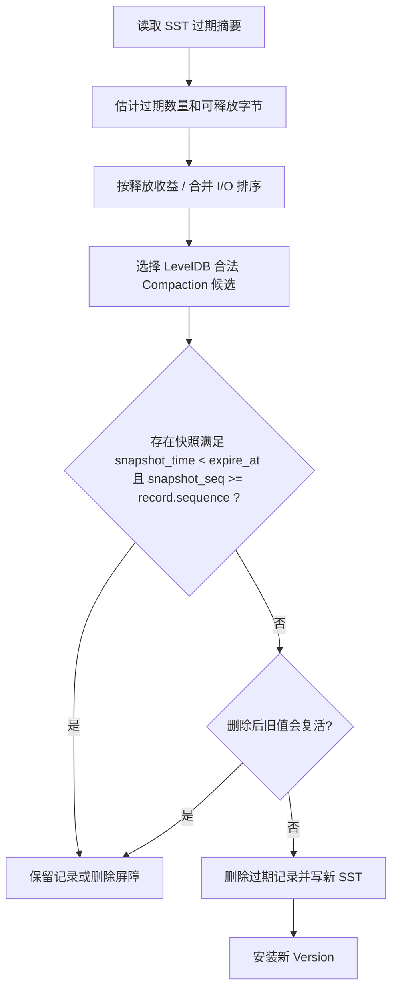

三个层次：

1. **摘要层**：快速估计哪个文件更值得检查。
2. **安全层**：检查快照、sequence 和旧值屏蔽条件。
3. **执行层**：重写 SST，并安装新的 Version。

本方案借鉴的论文思路：

| 来源                               | 论文中关注的重点                                      | 本方案怎样使用                                                  |
| ---------------------------------- | ----------------------------------------------------- | --------------------------------------------------------------- |
| Lethe+，TODS 2023                  | 区分逻辑删除和持久删除，通过 Compaction 推进删除      | 解释“读取先不可见，文件之后再回收”                              |
| Magma，PVLDB 15 (2022)，§7.1       | 为 SST 保存时间范围和到期数量，用过期比例辅助选择文件 | 用过期摘要安排候选，不把估计值当作安全证明                      |
| ArceKV，PVLDB 19 (2026)，§§3.2–3.4 | 用成本和长期收益安排合并动作                          | 简化为“预计释放字节 / 预计合并 I/O”                             |
| SlateDB RFC 0003                   | 使用显式到期字段，在读取、Compaction 时处理 TTL       | 参考记录格式和过期判断，接入 LevelDB 的 WAL、MemTable、SST 链路 |

论文链接：

- [Lethe+: Enabling Timely and Persistent Deletion in LSM-Engines](https://subhadeep.net/assets/fulltext/Enabling_Timely_and_Persistent_Deletion_in_LSM-Engines.pdf)
- [Magma: A Scalable and Elastic LSM-tree Based Key-Value Store](https://www.vldb.org/pvldb/vol15/p3496-lakshman.pdf)
- [ArceKV](https://www.vldb.org/pvldb/vol19/p958-liu.pdf)

固定 `snapshot_time`、最新过期版本屏蔽旧值以及最底层完整回收，是本项目根据作业语义提出的适配设计。

#### 2.9 一个完整时间线例子

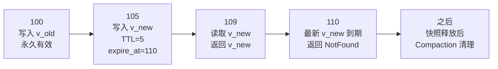

1. `t=100` 写入 `v_old`，没有截止时间。
2. `t=105` 写入 `v_new`，覆盖 `v_old`，保存 `expire_at=110`。
3. `t=109` 找到最新版本 `v_new`，`109 < 110`，返回 `v_new`。
4. `t=110` 仍先找到 `v_new`，但 `110 >= 110`，返回 `NotFound`。
5. `v_old` 不会因为 `v_new` 过期而复活。
6. 后台 Compaction 等旧快照不再需要这些版本后，才真正清理空间。

#### 2.10 TTL 的边界问题

##### `TTL=0` 怎么办

约定 `expire_at=0` 表示永久有效。读取时先判断 `expire_at==0`，直接跳过到期比较。

**所有需要显式特判 `expire_at==0` 的位置**：

| 位置                       | 特判方式                                                                           |
| -------------------------- | ---------------------------------------------------------------------------------- |
| `Version::Get` 的 TTL 判断 | `expire_at == 0` 直接视为可见                                                      |
| `DBIter` 过滤              | 同上                                                                               |
| `BuildTable` 统计过期摘要  | `expire_at == 0` 不计入 `expired_count`，不更新 `oldest/newest_expire_at` 的非零值 |
| Compaction 逐条安全判断    | `expire_at == 0` 的记录只走原生规则 A / 规则 B，不进入 TTL 保留条件                |

如果不做特判，`0 < now` 会把永久记录误判为已过期。


##### 重启会不会续期

不会。WAL 和 SST 保存绝对 `expire_at`，恢复时直接读取。`RecoverLogFile` 重放 `WriteBatch` 时，解析路径与正常写入一致，`expire_at` 原样恢复到 `MemTable`。

##### 批量写入路径

`WriteBatch` 中可同时包含普通 Put 和 TTL Put。普通 Put 使用 `kTypeValue` tag，TTL Put 使用 `kTypeValueWithTTL` tag，后者在 key 和 value 之间多一个 fixed64 的 `expire_at` 字段。`WriteBatch::Iterate` 按 tag 分发：普通 Put 调用 `handler->Put`，TTL Put 调用 `handler->PutWithTTL`。`MemTableInserter::PutWithTTL` 把 `expire_at` 写入 value 前 8 字节后插入 MemTable。重启恢复走同一 `Iterate` 路径，两种记录都能正确恢复。

### 三、初步设计结论与待验证项

#### 3.1 设计结论

本报告提出的 TTL 扩展保持 LevelDB 的内部版本组织和持久化链路不变，只增加记录级时间元数据以及读取、回收所需的时间视图。设计结论如下：

1. 写入时将相对 TTL 转换为绝对 `expire_at`，通过 `WriteBatch` 新增的 `kTypeValueWithTTL` 记录类型进入 WAL；在 MemTable 和 SST 中，TTL 记录的 value 以 8 字节前缀保存 `expire_at`，普通记录保持原始 value。恢复路径按 tag 解析并原样恢复。
2. 读取时使用 `sequence <= S` 的版本范围，并用固定 `snapshot_time=T` 判断到期。
3. 最新版本到期后直接返回 `NotFound`，`Version::Get` 以新增的终止状态作为结束，不回退到被覆盖的旧版本。
4. 读取不可见和物理删除分开，Compaction 只有在快照和版本屏障允许时才回收。TTL 安全条件只叠加在值记录上，删除标记仍走原生规则。
5. 文件级过期摘要通过新增 `VersionEdit` tag 持久化到 MANIFEST，只参与候选调度，逐条安全判断仍是删除的必要条件。
6. 快照通过扩展 `SnapshotImpl` 携带 `snapshot_time_`；迭代器在构造时固定 `ReadView`，不随 `Next()` 重新取时钟。

#### 3.2 设计边界

- `expire_at=0` 表示永久有效，所有判断点显式特判。
- 到期判断采用 `read_time < expire_at`，时间相等时记录不可见。
- 快照同时固定 `snapshot_seq` 和 `snapshot_time`。
- 重启直接恢复持久化的 `expire_at`，不重新计算 TTL。
- 完整回收需要覆盖最底层文件，并保持旧值屏蔽语义。
- 假设统一时钟单调，时钟回拨不在保证范围内。
- TTL 安全条件不接管删除标记；删除标记的回收仍由原生规则决定。

**一句话总结**：本设计先固定“用哪个 sequence、哪个时间判断可见性”，再规定“什么时候可以安全回收”，最后用文件级摘要优化调度。语义正确性优先于回收收益，回收收益再通过 benchmark 验证。


## LevelDB 元数据统计辅助 LSM 技术设计方案

本方案采用辅助 LSM 持久化全局每键记录重数，活动元数据 MemTable 对同一个 key 就地更新当前计数，并通过有界缓存控制热数据的内存开销。普通写入与统计更新使用同一条 WAL 事务；主数据 Compaction 的文件替换与统计变更记录由同一条 Manifest 事务决定是否提交。

### 1 统计对象与一致性约束

#### 1.1 三个统计值的含义

令 `P` 为当前已发布状态中的主数据内部记录集合，对原始 user key `k` 定义：

**`R(k) = P 中属于 k 的内部记录条数`**

| 指标                      | 定义                          | 更新依据                       |
| ------------------------- | ----------------------------- | ------------------------------ |
| `total_entries`，简称 `T` | 所有 `R(k)` 之和              | 主数据写入或记录回收的净变化   |
| `distinct_keys`，简称 `D` | `R(k)>0` 的原始 user key 数量 | 每键计数是否跨越零边界         |
| `seq`，简称 `S`           | 主数据已发布的 `LastSequence` | 原有用户写入序列分配与恢复规则 |

`P` 包含当前主数据 MemTable、immutable MemTable 和当前 Version 的 SST。旧版本、删除标记和尚未回收的过期 TTL 记录都属于内部记录。辅助 LSM 的计数项、删除标记、恢复记录及文件均不计入这些指标。

统计查询返回当前整体发布的 `T、D、S`。带快照的 `ReadOptions` 仍返回当前统计，本方案不提供用户历史快照统计。因此活动元数据 MemTable 可以合并同一个 key 的中间计数版本；冻结的内部恢复视图仍必须保持不变。

#### 1.2 用户序列号与元数据事务号

除了用户序列号 `S`，内部增加元数据事务号 `mseq`，为会改变 `R(k)` 的提交确定统一顺序。一个写入提交组对应一个元数据事务；一次改变记录集合的主数据 Compaction 也对应一个元数据事务。

两种编号职责不同：用户序列号描述主数据写入历史，元数据事务号排序普通写入和回收对统计的影响。元数据更新、元数据 Flush 和元数据 Compaction 不消耗用户序列号。事务号允许存在未提交造成的空洞，不能直接用事务号差值推算记录数。

所有已经发布的状态必须满足：

- `T = Σ R(k)`，`D = |{k : R(k)>0}|`；
- 一个完整 batch 的主数据、元数据更新和用户序列边界一起发布；
- 一次主数据 Compaction 的 Version 切换和统计变化一起发布；
- 原样 Flush、文件换层、元数据 LSM 自身的维护、旧文件最终删除均不重复改变计数；
- TTL 时间推进只改变读取可见性，只有安全回收并提交后才减少内部记录数。

### 2 元数据统计放在哪里以及如何持久化

#### 2.1 整体存储布局

辅助 LSM 与主数据 LSM 使用独立的内存表和 SST 文件集合，在同一数据库内部共享提交协调、WAL 和 Manifest。它不作为第二个互不协调的数据库实例运行。

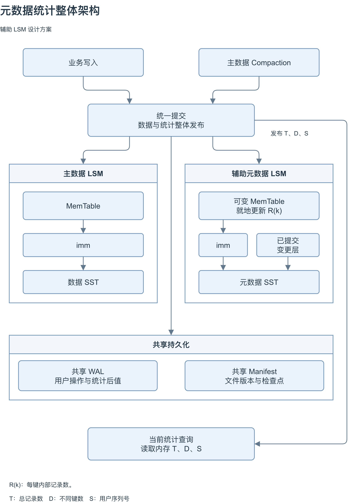

图中的“统一提交”协调业务写入与主数据 Compaction，使主数据状态、每键计数和全局统计整体发布；它是提交协调模块，不是额外的存储层。连线表示模块关系，具体持久化顺序分别见第 3、4 节。

两套 LSM 的 MemTable 和 imm 位于内存，SST 位于磁盘。辅助 LSM 的可变 MemTable 对 `R(k)` 就地更新，冻结为 imm 后不再修改；“已提交变更层”由已提交的有序变更文件及其查询入口组成，计数内容可以留在磁盘，并不要求全部加载到内存。imm 和变更层经元数据 Flush 合并为元数据 SST。

共享 WAL 保存前台用户操作及对应统计后值；共享 Manifest 管理两套文件版本、元数据检查点和已提交变更文件引用。统计查询只复制内存中的 `T、D、S`，不遍历辅助 LSM。图中省略了有界缓存、事务工作区和文件引用管理，其位置与职责如下表所示。

| 位置 | 保存内容 | 作用 |
| --- | --- | --- |
| 内存 活动元数据 MemTable | 最近修改的 key、最新绝对计数或删除标记、对应 `mseq` | 同 key 反复更新时就地覆盖当前计数 |
| 内存 冻结元数据 ImMTable | 冻结 MemTable、关联的已提交变更文件、冻结时的事务边界 | 为异步 Flush 提供不可变输入 |
| 内存 全局标量 | 当前 `T、D、S` 和已发布的元数据事务边界 | 统计查询直接整体复制 |
| 磁盘 元数据 SST | 每键绝对计数及其事务号，或屏蔽旧计数的删除标记 | 持久保存全局映射的分层版本 |
| 磁盘 共享 WAL | 用户 batch 与本次元数据更新的同一事务记录 | 恢复尚未形成检查点的前台更新 |
| 磁盘 已提交变更文件 | 主数据 Compaction 等大事务的每键计数后值 | 提供可重放记录及可查询的临时不可变层 |
| 磁盘 共享 Manifest | 两套 SST 文件集合、元数据检查点及未折叠变更文件的引用 | 决定文件安装与后台事务的提交状态 |

运行期不再要求全部不同 key 的 `R(k)` 常驻内存。一个 key 未出现在活动 MemTable 中，只说明本代没有它的最新修改；必须继续查询冻结代、已提交变更层或元数据 SST，不能据此判定 `R(k)=0`。

#### 2.2 活动 MemTable 的就地更新

活动元数据 MemTable 采用持有完整 key 的可变索引，例如哈希表。哈希值只用于定位，最终相等判断仍比较完整字节，避免碰撞影响精确性。一个活动代内，同一个 key 只保留最新的绝对计数和事务号。即这里不采用一般 LSM 的追加写方式，而是采用就地更新的方式。这样做的原因有以下几点：1、**减少热点更新的内存占用。**为了不过多占用正常数据库操作的资源，辅助 LSM 的MemTable的大小应该是非常有限的。一个 key 在同一代内更新一万次，可以只保留一个当前计数项。这样可以减少内存占用；2、**元数据通常只关注当前的状态，而不必考虑历史版本。**因此无需通过追加写的方式来维护历史修改。关于故障恢复的问题我们可以使用 WAL 的方式来解决；3、**减少分配和复制。**已有项可以直接修改计数，省去重复分配节点和插入新版本的工作。我们的计数是固定宽度整数，适合这种更新。

例如，持久层中 `R(a)=5`，本代第一次更新时把新计数 6 放入活动表；随后两次更新在同一项上将计数改为 7、8。正常 Flush 只需输出本代的最终值 8。主数据中这几次写入产生的内部记录仍全部保留并计数，合并的只是辅助存储中的中间计数状态。

活动表保存绝对后值，而不是保存 `+1/-1` 的增量。这样每次变更都能明确判断计数是否从零变正或从正变零，并据此维护 `D`。

第一次修改未驻留的 key 时，需要查辅助 LSM 的 ImMTable 和 SST 等以获取其当前完整计数；随后命中活动表的更新可以直接改值。

活动表设定字节预算。达到预算后冻结，后续更新进入新活动表，冻结后的内容不再修改。冻结代数量、缓存和事务工作区都纳入预算；Flush 跟不上时通过调度前台限制新增写任务，不能无限堆积 immutable MemTable。

#### 2.3 读取某个 key 的当前计数

内部计数查找MemTable、Immutable MemTable、已提交变更层（compaction 的变更）和元数据 SST，选择该 key 事务号最大的已提交值。通常活动表包含最新更新，可以快速命中；存在尚未折叠的后台变更层时，必须检查其事务边界，不能固定认为活动表中的项永远比所有磁盘项新。

有界缓存保存带事务号的结果。提交修改相关 key 时同步更新或失效缓存；后台安装变更层也要推进缓存有效性边界。缓存只影响开销，不决定计数正确性。

元数据 SST 使用按块索引、校验、压缩及按需加载的 Bloom filter。Bloom filter 的确定不存在结果可以跳过文件，可能存在结果仍要查精确 key。表缓存、索引块及过滤器也要有容量约束，不能为了减少计数映射内存，又把所有文件的完整键目录加载进内存。

#### 2.4 计数归零必须保留删除标记

假设旧元数据 SST 中保存 `R(a)=4`，回收后 `R(a)=0`。活动 MemTable 必须写入该 key 的删除标记，屏蔽低层旧计数。若只是移除活动表中的项，后续查找可能再次读到旧值 4。

只有辅助 LSM 的 Compaction 确认相关旧计数已全部被覆盖，且内部冻结视图不再需要该标记，才允许丢弃元数据删除标记。元数据删除标记不属于主数据 Delete 记录，也不增加 `T` 或用户 `S`。

#### 2.5 共享日志的保留和持久化顺序

主数据和元数据可能以不同速度 Flush。因此需要分别保存主数据恢复边界和元数据恢复边界：主数据已落盘、元数据未落盘时，WAL 仍要为元数据保留；元数据已落盘、主数据未落盘时，WAL 仍要为主数据保留。

有一个问题是：统计后值可能包含此前 `sync=false` 的用户写入。主数据 Flush、Compaction 提交或元数据检查点若要把依赖这些写入的状态持久化，必须先通过共享提交队列完成相应 WAL 前缀的同步，或确认依赖的主数据及统计已经有完整持久副本。不能让统计后值或数据文件先持久化，而其另一侧恢复事件仍可能丢失。

这会使部分原本未同步的写入在后续后台操作中被一并持久化，符合它们允许延后持久化的语义，但增加了后台同步成本。

### 3 常规 batch 到来时如何更新

#### 3.1 批内先汇总每个 key 的操作数

Put、TTL Put、Delete 各产生一条主数据内部记录。对提交组中的每个原始 key 汇总操作数 `n(k)`：

**`R_after(k) = R_before(k) + n(k)`**

**`T_after = T_before + Σ n(k)`**

**`D_after = D_before + |{k : R_before(k)=0 且 n(k)>0}|`**

同一 batch 对一个 key 操作多次，内部记录数逐条增加，不同键数最多增加一次。删除一个从未存在的 key 也会产生主数据删除标记，因此它的记录重数从零变正。

沿用原有组批机制时，可以把多个调用者的 batch 组成一个提交事务，再按 key 汇总。每个调用者的 batch 仍保持原子，不因内部处理分块而暴露部分结果。

#### 3.2 查旧值和内存修改的位置

对本批涉及的每个不同 key，先在活动表中查找有效当前计数；未命中或存在更新的后台变更层时，再查询完整元数据 LSM。只在全部可见来源均不存在该 key，或最新记录为删除标记时，认定旧计数为零。

查到旧值后，在事务私有工作区计算后值和 `T_after、D_after`。此时不修改已发布活动表。私有准备保证 WAL 或校验失败不会把尚未提交的计数暴露给后续操作。

同一活动代内的热 key 在后续提交时通常可以直接取得当前计数；首次访问、代切换和工作集超过缓存时仍可能需要读取元数据 SST。就地更新减少重复版本，不能消除所有写前查找。

#### 3.3 一次完整提交的顺序

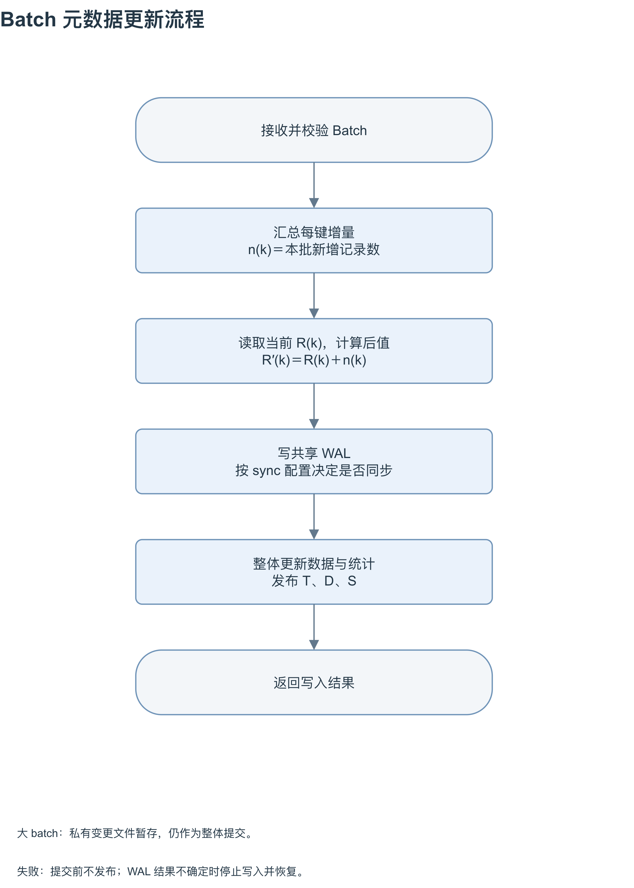

图中的 `n(k)` 是本批为 key 新增的主数据内部记录数，Put、TTL Put 和 Delete 均计入。流程先在私有工作区准备后值，再写共享 WAL，最后整体发布；“读取当前计数并计算后值”必须在统一提交顺序内完成，直到本批发布前，其他改变统计的事务不得越过。普通规模的后值就地写入活动 MemTable，大 batch 可以整体挂接已提交变更层，两者都只进行一次对外可见的提交。

其中“按 sync 配置决定是否同步”指：`sync=true` 必须在发布和返回前完成本事务所需的 WAL Sync；`sync=false` 仍追加完整 WAL 事务，但本次返回不要求它已经同步。后续持久化操作若依赖这些更新，仍须满足第 2.6 节的 WAL 前缀持久化约束。


### 4 主数据 Compaction 后如何更新

#### 4.1 扫描阶段计算净差量

主数据 Compaction 对每个 key 汇总输入、输出的实际内部记录数：

**`Δ(k) = output_count(k) − input_count(k)`**

被覆盖版本、可安全删除的主数据删除标记和到期 TTL 记录从输出省略时，形成负差量。保留下来的记录在输入扣减和输出增加之间相互抵消，差量只描述本任务替换的记录集合。

#### 4.2 提交前读取最新计数

扫描和构建数据 SST 期间允许前台写入。进入最终提交顺序后，对差量涉及的 key 查询最新元数据状态，再计算：

**`R_after(k) = R_latest(k) + Δ(k)`**

**`T_after = T_latest + Σ Δ(k)`**

**`D_after = D_latest + Σ (1[R_after(k)>0] − 1[R_latest(k)>0])`**

所有后值必须非负，计数溢出、下溢或索引来源异常都应终止提交并报告错误，不能截断或钳制为零。新计数为零时生成元数据删除标记。

#### 4.3 明确选择 Manifest 提交加可重放变更文件

仅在 `LogAndApply` 后修改内存无法满足辅助 LSM 的持久一致性：进程可能在 Version 已安装、元数据尚未更新时崩溃。因此本方案为每次改变记录集合的主数据 Compaction 准备独立的元数据变更文件。

该文件按 key 保存最终绝对计数或删除标记，以及任务标识、事务号、格式、校验和全局汇总后值。扫描形成的带符号差量是准备材料；最终提交文件保存基于最新状态计算的后值，便于幂等恢复。


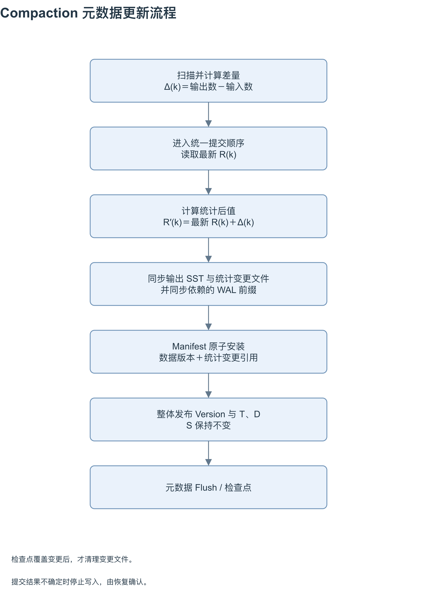

图中 `Δ(k)` 只反映本次任务输入与输出的记录数之差；`R′(k)` 则基于进入统一提交顺序后的最新全库计数计算，包含扫描期间已经提交的前台写入。“同步输出、变更文件及 WAL 依赖”表示这些持久化条件必须在 Manifest 提交前满足，不要求已经同步完成的输出 SST 再同步一次。

Manifest 原子安装决定数据文件替换与统计变更是否一起成立；随后在状态锁下整体发布新 Version 与 `T、D`，用户序列号 `S` 保持不变。末尾的“元数据 Flush / 检查点”是发布后的异步整理，不是本次 Compaction 生效的前提。只有检查点已覆盖该事件、且没有冻结代或读引用仍需使用时，才可清理对应变更文件。

已提交变更文件兼有持久重放来源和可查询层的作用。它可以使用可索引的有序块格式，不要求先把所有后值加载进活动表。这样在后台折叠尚未完成时，后续更新仍能读到已经提交的新计数。

元数据后值以事务号确定新旧；不能让迟到的变更层覆盖活动表中更晚提交的值。元数据代冻结时同时捕获其边界内所有变更层，外部归并后保留每个 key 的最新后值。

#### 4.4 失败和文件生命周期

准备文件成功但 Manifest 未提交时，它没有生效，不能改变统计。安装失败或结果不确定时，不继续提交依赖其结果的新事务，重启按有效 Manifest 事务确定最终状态。

Manifest 轮换必须把检查点之后尚未折叠的变更事务引用写入新快照。即使某次 Compaction 的输出数据文件后来又被另一轮 Compaction 替换，前一事务的统计变更文件也不能因此提前删除；恢复仍可能需要按顺序重放它。

回收变更文件的条件是元数据检查点已经包含该事件，且没有冻结代或读引用需要它。

### 5 问题四 崩溃后如何恢复

#### 5.1 正常恢复的两个来源

主数据以原有 Manifest 和 WAL 恢复结果为准；元数据以已安装的辅助 LSM 检查点和其后已提交的事务为准。正常打开不再扫描全库 key 来构造全量内存映射。

元数据检查点的 `T_H、D_H` 是边界 `H` 的汇总后值。检查点之后，前台事务来自共享 WAL，后台回收事务来自 Manifest 已确认的变更文件。两者按元数据事务号合并重放，得到与最终主数据状态一致的统计。

#### 5.2 打开数据库的完整顺序

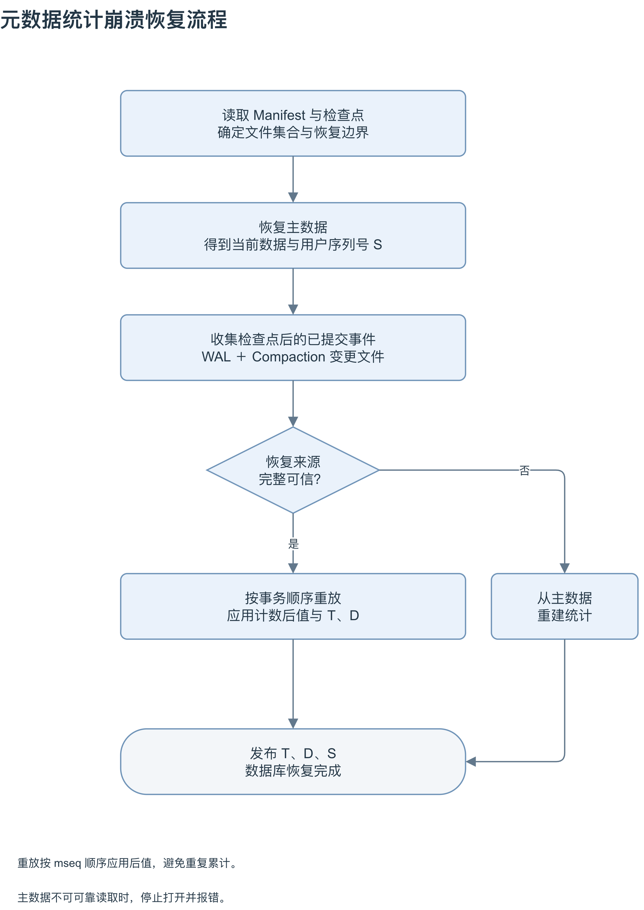

图中主路径依次确定文件与恢复边界、恢复主数据、收集检查点后的已提交事件、校验来源、按事务顺序重放，最后统一发布。元数据检查点的装载包含在前面的检查点准备中；`S` 来自主数据恢复结果，`T、D` 由检查点汇总值与尾部事件后值恢复。WAL 中的前台事务与 Manifest 确认的后台变更按 `mseq` 合并排序，不能按文件读取先后直接应用。

恢复来源完整可信涵盖元数据检查点、必要日志和已提交变更文件的完整性及边界一致性；重放过程中仍须检查计数和最终边界，图中的一次判断不代表后续可以跳过校验。发现元数据来源不可信时，走右侧分支，从可靠恢复后的最终主数据重建统计；若主数据本身不可可靠读取，则终止打开并报错。重放或重建完成且验证通过之前，不对外开放数据库。

恢复期间产生检查点只改变已经恢复部分的持久表示，不意味着可以提前暴露尚未追平的统计。中途再次崩溃，仍从最近完整检查点继续恢复。

#### 5.3 典型崩溃位置

| 崩溃位置                                        | 恢复行为                                               |
| ----------------------------------------------- | ------------------------------------------------------ |
| WAL 末尾事务未完整写入                          | 丢弃不完整尾事务，用户数据和对应元数据都不按该事务重放 |
| WAL 有完整事务，内存尚未整体发布                | 按两侧恢复边界分别恢复，不能只恢复用户记录             |
| 主数据已 Flush，元数据尚未检查点化              | 保留的 WAL 补齐元数据，不重复插入已落盘用户记录        |
| 元数据检查点已安装，主数据尚未 Flush            | WAL 仍为主数据保留；元数据跳过已包含事务               |
| 数据输出和元数据变更文件写完，Manifest 尚未提交 | 继续使用旧 Version；这些文件是未提交输出               |
| Manifest 已提交，统计尚未内存发布               | 使用新 Version，并重放该事务引用的元数据后值           |
| 元数据 SST 写完，检查点 Manifest 未提交         | 继续使用旧检查点和其恢复来源，不提前删除日志           |

WAL 或 Manifest 同步返回错误时，调用结果可能不确定。恢复只承认完整、可校验且满足提交协议的事务，不根据崩溃前某个线程是否已返回成功来推断磁盘状态。

#### 5.4 日志损坏与元数据重建

一个事务的用户记录和元数据更新必须使用同一完整性边界。对不完整的日志尾部可以整体丢弃；若中间日志损坏，或既有主数据恢复策略跳过了某个事务，后续绝对计数可能仍包含被跳过事务的贡献，不能直接继续沿用。

本方案在发现这类情况时，将增量元数据恢复标记为不可信。若主数据可按既定策略可靠恢复，则对其最终状态完整重建元数据。

元数据 SST 或必要的已提交变更文件缺失、损坏，检查点不一致，也进入同一重建流程。

重建即全量扫描主数据，建立最新的，正确的完整统计元数据。
